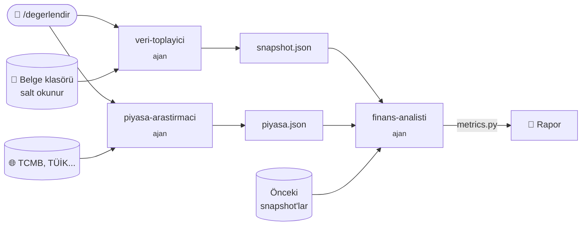

<div align="center">

# 💰 Finansal Asistanım

**Claude Code üzerinde çalışan, kişisel finans durumunuzu her ay değerlendiren açık kaynak bir ajan sistemi**

[](https://github.com/katmacaoglu/finansal-asistanim/actions/workflows/test.yml)
[](LICENSE)
[](https://www.python.org/)
[](CHANGELOG.md)

[Ne yapar?](#ne-yapar) · [Kurulum](#kurulum) · [Kullanım](#kullanım) · [Nasıl çalışır?](#nasıl-çalışır) · [SSS](#sık-sorulan-sorular) · [Katkı](CONTRIBUTING.md)

</div>

---

> [!WARNING]
> Bu araç bir **analiz yardımcısıdır, yatırım danışmanlığı değildir.** Belirli hisse, fon veya kripto önermez.
> Kararlarınızı kendiniz verin, gerekirse lisanslı bir danışmana başvurun.

## Ne yapar?

Her ay şu soruyu sorduğunuzu düşünün: *"Elimde bu kadar nakit var, bu borçlarım var. Durumum ne, önce ne yapmalıyım?"*

Normalde bunu her seferinde bir yapay zekâya baştan anlatırsınız. Finansal Asistanım ise bu işi kalıcı bir sisteme dönüştürüyor:

- 📂 **Belgelerinizi kendisi okur.** Banka ekstreleri, kredi planları, Excel tabloları ve notlar Google Drive'da ya da yerel bir klasörde durabilir.
- 🌐 **Güncel veriyi web'den çeker.** TCMB politika faizi, kredi kartı faizi, enflasyon ve kurlar her seferinde kaynağıyla birlikte alınır.
- 🧮 **Hesabı kod yapar, yapay zekâ yorumlar.** Faiz, borç kapatma süresi ve oranlar Python ile hesaplanır. Rakam uydurulmaz.
- 📈 **Geçmişi hatırlar.** Her ay standart bir kayıt (snapshot) tutar ve "geçen aya göre ne değişti" sorusunu cevaplar.
- 🔒 **Verileriniz sizde kalır.** Kişisel her şey `.gitignore`'dadır. Belge klasörünüz salt okunur kullanılır.

### Örnek çıktı

```
## Özet
Net değer pozitif (267.000 TL), ama varlığın yarısı likit değil ve acil durum fonu 3 ayın altında.
En pahalı sorun kredi kartları: yıllık bileşik maliyetleri %55,5, yani enflasyonun yaklaşık 20 puan üstünde.

| Senaryo                     | Kapanış süresi | Toplam faiz |
|-----------------------------|----------------|-------------|
| Sadece mevcut ödemeler      | 10 ay          | 52.451 TL   |
| Çığ (yüksek faiz önce)      | 7 ay           | 38.772 TL   |
```

👉 Raporun tamamı: **[docs/ornek-rapor.md](docs/ornek-rapor.md)** (uydurma verilerle)

## Kurulum

### Gereksinimler
| | Neden | |
|---|---|---|
| [Claude Code](https://docs.claude.com/en/docs/claude-code/overview) | Ajanları çalıştıran ortam | Zorunlu |
| [Python 3.9+](https://www.python.org/downloads/) | Hesap ve doğrulama script'leri | Zorunlu |
| `pandas`, `openpyxl` | Excel dosyalarını okumak | Opsiyonel |
| [Google Drive for Desktop](https://www.google.com/drive/download/) | Belgeleriniz Drive'daysa | Opsiyonel |

### Üç adımda kurulum

**1. Projeyi indirin**
```bash
git clone https://github.com/katmacaoglu/finansal-asistanim.git
cd finansal-asistanim
pip install pandas openpyxl     # opsiyonel, Excel için
```

**2. Belge klasörünüzü tanıtın**
```bash
python3 kurulum.py
```
Script bilgisayarınızdaki Google Drive konumunu bulmaya çalışır ve size hangi klasörü kullanmak istediğinizi sorar.
Drive kullanmıyorsanız boş bırakın. Bu durumda belgelerinizi proje içindeki `veri/kaynak/` klasörüne koyarsınız.

**3. Claude Code'u açın ve profilinizi oluşturun**
```bash
claude
```
```
/kurulum
```
Asistan size gelir, sabit giderler, hedefler ve risk tercihi hakkında birkaç kısa soru sorar ve `veri/profil.md` dosyanızı oluşturur.

> [!TIP]
> Kurulumdan sonra Claude Code'u bir kez kapatıp açın. Klasör izinleri ancak böyle devreye girer.

### Klasörünüze ne koymalısınız?
| Belge | Format | Not |
|---|---|---|
| Kart ve hesap ekstreleri | PDF | Dönem borcu, asgari ödeme ve faiz oranı buradan okunur |
| Kredi ödeme planları | PDF | Kalan anapara ve taksit sayısı |
| Varlık ve borç listesi | `.xlsx` / `.csv` | Google Sheets kullanıyorsanız ayda bir `.xlsx` olarak dışa aktarın* |
| Serbest notlar | `.md` / `.txt` | "50 gram altınım var" gibi bilgiler |

<sub>*Google Drive for Desktop, Sheets dosyalarını bilgisayarda içeriği olmayan kısayollar olarak tutar.</sub>

Hepsini koymanız gerekmiyor. Eksik bilgiyi asistan size sorar.

## Kullanım

Ayda bir, ya da maaş günü, ya da büyük bir harcamadan sonra:
```
/degerlendir
```
Asistan önce o ana ait bilgileri sorar: elinizdeki nakit, Drive'a girmemiş yeni borçlar, özel durumlar. İsterseniz bunları en baştan da verebilirsiniz:
```
/degerlendir elimde 60 bin nakit var, A kartına bu ay 20 bin ödedim. Araba almalı mıyım diye düşünüyorum
```
Birkaç dakika sonra rapor `raporlar/2026-11-22-degerlendirme.md` dosyasına yazılır ve özeti sohbette görünür.

Takip soruları da sorabilirsiniz:
- *"Serbest nakdin %80'ini borca versem ne değişir?"*
- *"Mevduatı bozup kartı kapatmak mantıklı mı?"*
- *"Son üç ayda net değerim nasıl değişti?"*

## Nasıl çalışır?



| Parça | Ne işe yarar | Neden ayrı |
|---|---|---|
| **Ajanlar** (`.claude/agents/`) | Her biri ayrı bir context'te çalışan uzman | PDF ve web sayfaları ana sohbeti doldurmaz. Yetkiler de ayrılır: araştırmacı dosyalarınızı göremez, analist internete çıkamaz |
| **Skill'ler** (`.claude/skills/`) | Gerektiğinde yüklenen bilgi: veri şeması, değerlendirme kuralları, rapor şablonu | Context'te sadece açıklamaları durur, içerik ihtiyaç olunca yüklenir |
| **Script'ler** (`scripts/*.py`) | Hesaplama ve doğrulama | Yapay zekâ hesap yapmaz, yorumlar |
| **Snapshot'lar** (`veri/snapshots/`) | Her dönemin aynı formatta kaydı | Zaman içinde karşılaştırma yapılabilir |

<details>
<summary><b>Hesaplanan metrikler</b></summary>

| Metrik | Açıklama |
|---|---|
| Net değer | Toplam varlık − toplam borç (döviz ve altın güncel kurla TL'ye çevrilir) |
| Likit varlık | 1 hafta içinde zararsız nakde dönebilen varlıklar |
| Acil durum fonu | Likit varlık ÷ aylık toplam çıkış (gider + borç ödemesi) |
| Borç ödemesi / gelir | Aylık borç ödemelerinin gelire oranı |
| Yıllık bileşik faiz | Aylık faizin 12 ay bileşik karşılığı |
| Reel faiz | Borç maliyetinin enflasyondan arındırılmış hali |
| Borç kapatma | Mevcut ödemeler, çığ ve kartopu yöntemleriyle ay ay simülasyon |

</details>

<details>
<summary><b>Klasör yapısı</b></summary>

```
finansal-asistanim/
├── CLAUDE.md                         # Proje hafızası ve kurallar
├── kurulum.py                        # Kullanıcıya özel ayarlar
├── .claude/
│   ├── settings.json                 # Ortak izinler
│   ├── agents/
│   │   ├── veri-toplayici.md
│   │   ├── piyasa-arastirmaci.md
│   │   └── finans-analisti.md
│   └── skills/
│       ├── kurulum/                  # /kurulum
│       ├── degerlendir/              # /degerlendir
│       ├── finansal-snapshot/        # Veri şeması + validate.py
│       └── finansal-analiz/          # metrics.py + kurallar + şablon
├── veri/
│   ├── profil.ornek.md               # Profil şablonu
│   ├── ornek/                        # Test verisi
│   ├── kaynak/                       # Drive yoksa belgeler buraya
│   └── snapshots/                    # Aylık kayıtlar (git'e girmez)
├── raporlar/                         # Raporlar (git'e girmez)
├── docs/
└── tests/
```

</details>

## Kendinize göre uyarlama

| Değiştirmek istediğiniz | Dosya |
|---|---|
| Sağlıklı / kritik eşikleri | [`degerlendirme-kurallari.md`](.claude/skills/finansal-analiz/references/degerlendirme-kurallari.md) |
| Rapor formatı | [`rapor-sablonu.md`](.claude/skills/finansal-analiz/references/rapor-sablonu.md) |
| Yeni varlık veya borç türü | [`schema.json`](.claude/skills/finansal-snapshot/schema.json) içindeki `enum` listeleri |
| Kullanılan model | Ajan dosyalarındaki `model:` alanı (`inherit`, `opus`, `sonnet`, `haiku`) |
| Borca ayrılan serbest nakit oranı | Sohbette söyleyin ("%70 ile hesapla") |

## Gizlilik ve güvenlik

- **Repoya girmeyenler:** `veri/ayarlar.json`, `veri/profil.md`, `veri/snapshots/`, `veri/kaynak/`, `raporlar/`, `.claude/settings.local.json`
- **Belge klasörünüz** izinlerle salt okunur yapılır. Asistan oraya yazamaz, oradan dosya silemez.
- **Ağ erişimi** sadece arama ve sayfa okuma araçlarıyla yapılır. `curl` ve `wget` kapalıdır.
- **Bilmeniz gereken:** Analiz sırasında belgelerinizin içeriği Claude'a (Anthropic) gönderilir. Bu sizin için uygun değilse bu aracı kullanmayın.

Ayrıntılar: [SECURITY.md](SECURITY.md)

## Sık sorulan sorular

<details>
<summary><b>Claude Code olmadan çalışır mı?</b></summary>

Hayır. Ajan ve skill dosyaları Claude Code formatında. `metrics.py` ise tek başına da çalışır:
`python3 .claude/skills/finansal-analiz/scripts/metrics.py veri/ornek/snapshot-ornek.json --piyasa veri/ornek/piyasa-ornek.json`
</details>

<details>
<summary><b>Bankama bağlanıyor mu?</b></summary>

Hayır. Bankacılık şifresi veya API kullanmaz. Sadece sizin indirdiğiniz belgeleri okur.
</details>

<details>
<summary><b>Rakamlar ne kadar güvenilir?</b></summary>

Hesaplar test edilmiş Python kodu ile yapılır. Ama çıktı, girdinin doğruluğuyla sınırlıdır. Snapshot oluşunca asistan size okuduğu kalemleri ve uyarıları gösterir, kontrol edin.
Simülasyon faiz oranlarının sabit kaldığını varsayar.
</details>

<details>
<summary><b>Türkiye dışında kullanılabilir mi?</b></summary>

Şu an kurallar ve piyasa kaynakları Türkiye odaklı. Başka bir ülke için `piyasa-arastirmaci.md` ve `degerlendirme-kurallari.md` dosyalarını uyarlamanız gerekir. Bu konuda katkılara açığız.
</details>

<details>
<summary><b>Ne kadar maliyet çıkarır?</b></summary>

Claude Code aboneliğiniz veya API kullanımınız üzerinden çalışır. Bir değerlendirme; belge sayısına bağlı olarak birkaç ajan çağrısı ve birkaç web araması kullanır.
Analist ajanı varsayılan olarak `opus` kullanır. Maliyeti düşürmek için `model:` alanını değiştirebilirsiniz.
</details>

## Yol haritası
- [ ] Döviz ve altında kur etkisini birikimden ayıran metrik
- [ ] Net değer zaman serisi grafiği
- [ ] Google Drive MCP ile doğrudan bağlantı seçeneği
- [ ] Başka ülkeler ve para birimleri için kural setleri
- [ ] Bütçe takibi (harcama kategorileri)

Fikriniz mi var? [Bir issue açın](https://github.com/katmacaoglu/finansal-asistanim/issues/new/choose).

## Katkıda bulunma
Hata bildirimi, yeni kural setleri ve kod katkıları memnuniyetle karşılanır. Başlamadan önce [CONTRIBUTING.md](CONTRIBUTING.md) dosyasını okuyun.

## Lisans
[MIT](LICENSE). Özgürce kullanabilir, değiştirebilir ve dağıtabilirsiniz.

---

<details>
<summary>🇬🇧 English summary</summary>

**Finansal Asistanım** is an open-source Claude Code project that evaluates your personal finances every month.
Three sub-agents collect data from your documents (bank statements, loan schedules, spreadsheets), fetch current
Turkish market data (central bank rate, CPI, FX) from the web, and write a comparative report.
All numbers are computed by tested Python scripts, not by the LLM. Personal data never leaves your machine through git.
Currently Turkey/TRY focused; contributions for other countries are welcome.
</details>
